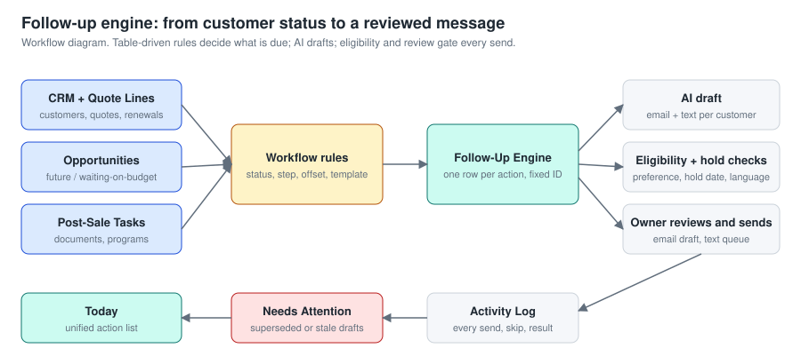
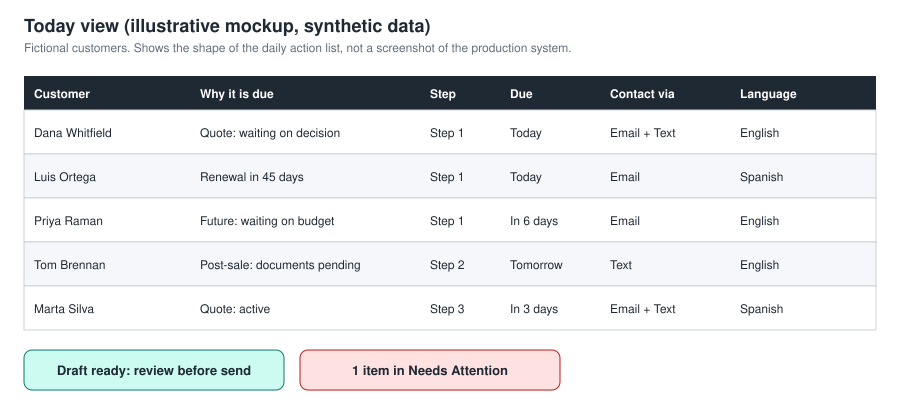

# Case Study 1: Sales Follow-Up CRM for an Insurance Agency

**Focus:** business systems design and workflow automation
**Role:** designer, builder (AI-assisted), tester, and daily user
**Stack:** web app on a Postgres database (Supabase), migrated from a Google Sheets workbook.
**Status:** in daily use by me. Presented to agency leadership, who considered integration into the existing CRM. Not integrated company-wide.

> Employer-related work. This page is a high-level case study. It contains no source code, customer data, or internal documents. All visuals use fictional customers.

## Executive summary

Insurance sales is a follow-up business. Quotes go cold when nobody checks back at the right time, in the right channel, in the customer's language. I built a follow-up CRM that turns each customer's status into a dated, reviewable action: who to contact today, why, through which channel, with a drafted message ready to review. I use it every day. I presented it to the agency's Sales Director and Operations Manager, and leadership considered integrating it into the agency's existing CRM.

## The business problem

- Quote follow-ups depended on memory and scattered notes.
- A customer can have several things in flight at once: an open quote, a renewal, a future opportunity, and post-sale paperwork. One status column could not represent that.
- Generic follow-ups ignore contact preference and language.
- A system that drafts messages automatically needs guardrails, or it contacts people it should not.

## Requirements I set

1. One daily list of what is due, across every kind of follow-up.
2. Timing rules that I can change without editing code.
3. Messages that sound personal, drafted fast, always reviewed by a person before sending.
4. Respect for contact preference, preferred language, and "hold until" dates.
5. A record of everything that was drafted, sent, skipped, or superseded.

## Solution

```
Customer, quote line, opportunity, and post-sale task records
        -> workflow rules (status + step + offset days + template)
        -> follow-up queue (one row per action, deterministic ID)
        -> AI-drafted email and text
        -> eligibility and hold checks
        -> owner reviews and sends
        -> activity log, Today view, Needs Attention view
```



### What I verified in the system

I checked the database schema and the original workbook structure. No customer data is reproduced here.

| Capability | Evidence |
|---|---|
| Relational data model | 14 tables: customers, policy lines, opportunities, post-sale tasks, follow-up queue, text queue, documents, activity log, templates, workflow rules, settings, import batches, request log, job leases. Foreign keys tie every record to its customer |
| Separate records for customers, quote lines, opportunities, and post-sale tasks | Dedicated tables with their own stages and follow-up fields |
| Rules in tables, not code | A workflow-rules table holds status, step, trigger basis, offset days, template key, and an enabled flag, scoped to customer, opportunity, or task (31 rules) |
| Template library | 33 templates keyed to workflow steps |
| Data isolation | Row-level security is enabled on every table, and each row carries an owner |
| Safe migration | The workbook was imported through tracked import batches, which have fields for record counts and a validation summary |
| Safe retries | A request log stores each request's ID and digest, so a repeated request returns the stored response instead of repeating the work |
| Document tracking | Policy documents are recorded with a file hash, version date, and a link to the document they supersede |
| Current scale | 16 customer records, 66 queued follow-up actions, 92 activity-log events |
| Idempotent queue | Each queue row has a deterministic ID built from record, action, and due date, plus a version stamp, so a rerun does not duplicate work |
| AI-drafted messages | Queue rows record the draft source, model, and a hash of the context used |
| Email and text channels | Separate email and text status, sent timestamps, skip reasons, and a text queue |
| Safeguards | Preferred language, contact preference, hold-until date, and eligibility columns; superseded drafts are flagged so they are not sent |
| Audit trail | Activity log with event time, result, source, and channel |
| Scheduler | Built but switched off. A runtime flag keeps scheduled automation disabled until I enable it |
| Renewal tracking | Renewals view for the next 60 days |

### Design decisions

- **Rules as data.** Follow-up cadence is a table. Changing "day 1, 4, 8" to something else takes a one-row edit.
- **Human in the loop.** The AI drafts. I review and send. This was a deliberate choice for a regulated, relationship-driven business.
- **Superseded handling.** When a customer's status changes, older queued drafts are marked superseded and surfaced for cleanup instead of silently going out.
- **Spreadsheet first, database second.** I proved the workflow in Google Sheets, where the rules were easy to see and change, then moved it to a relational database once the model was stable. The move added data isolation, retry safety, and a path to a web interface.



## My role

- Defined the problem, the record model, and the follow-up logic from my own sales workflow.
- Specified the guardrails and review steps.
- Built the system with AI coding assistance, directing the design and reviewing the output. I specified the data model and the migration plan.
- Tested changes against a pre-change backup before applying them. A dated backup of the original workbook exists for that purpose.
- Use it daily, which is where most of the improvements came from.

## Results

Verified:
- The system is in daily use for my own customer follow-ups.
- I presented it to the agency's Sales Director and Operations Manager. Leadership considered integration into the existing CRM.

Not claimed:
- No company-wide rollout or integration has happened.
- No measured lift in conversion or retention yet. See "Next steps".

## Challenges and lessons

- **Status was not enough.** A customer with a quote and a renewal needs two clocks. Splitting records by type fixed this.
- **Drafts go stale.** The first version let old drafts linger. Adding superseded states and a Needs Attention view fixed it.
- **Automation needs a brake.** Hold dates, contact preference, and review-before-send came from real near-misses in daily use.

## Next steps

- Track quote-to-bind rate before and after consistent follow-up, so impact can be stated in numbers.
- Document a clean hand-off path if leadership wants to fold the workflow into the agency CRM.
