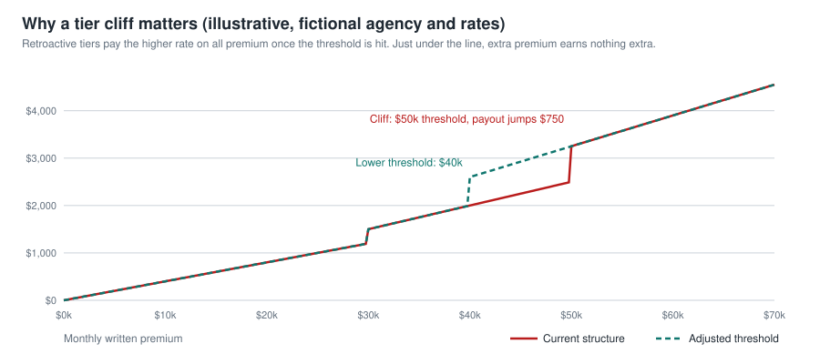
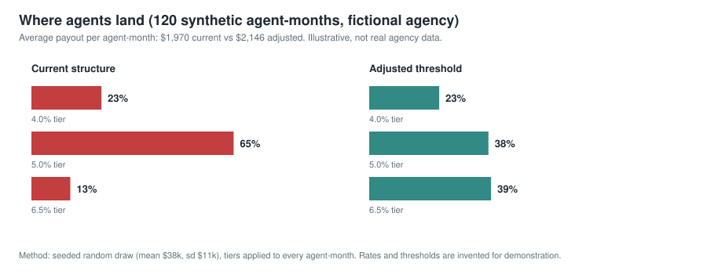

# Case Study 2: Commission Tracker and Compensation Analysis

**Focus:** financial modeling and measurable organizational impact
**Role:** analyst and builder (AI-assisted)
**Status:** used by two agents. Broader adoption under consideration.

> Employer-related work. All figures, rates, agents, and carriers on this page are fictional. They illustrate the method, not the agency's compensation plan.

## Executive summary

I built a commission tracker in Google Sheets that logs written premium, applies the compensation tier, and projects earnings. Using it, I found that the structure of the premium production requirements produced results that did not match their intent. I took the analysis to management. Management confirmed that my findings directly influenced an agency-wide adjustment to premium production requirements.

## The business problem

Agents are paid on a tiered structure tied to monthly written premium. Agents could not easily answer basic questions: where am I against the next tier, what is one more policy worth, what happens if the tier changes? Without those answers, nobody could tell whether the structure was doing its job.

## What the tracker does

I verified these against the live workbook's structure.

| Area | Function |
|---|---|
| Sales Log | One row per policy: date, customer, carrier, policy type, written premium, multi-line household flag, state, status. Running monthly premium and base commission calculated per row |
| Commission Calculator | Scenario inputs on one side, estimate on the other. Models any tier without touching the live dashboard |
| Dashboard | Active tier, written premium, estimated commission with bonuses, policy count, multi-line rate, goal progress |
| Monthly History | Per month: premium, policies, average sale, estimated commission, goal progress, premium to goal, goal hit, multi-line rate, applied tier |
| Carrier and State Summary | Policies, premium, average premium, and share of premium by carrier and by state, for any chosen month |
| Archive | Read-only prior months, selectable from a dropdown, so the live log stays current |
| Performance Records | Best-month comparison and distance to it |

## How I approached the analysis

1. Capture every policy with the fields that drive pay.
2. Calculate commission the way the plan describes it, including tier and bonuses.
3. Compare months side by side: premium, tier applied, commission.
4. Model alternatives in the calculator without changing live numbers.
5. Look for places where the same effort produces very different pay.

## Illustration: how a tier cliff distorts behavior

The agency's real structure is confidential, so this uses an invented one. Suppose pay is a flat percentage of all premium, with the rate set by tier thresholds.

Under the invented current structure, an agent at $49,900 earns $2,495. One $100 policy later, at $50,000, the agent earns $3,250: a $755 jump for $100 of premium. Below the line, extra effort is thinly rewarded. The top threshold also sits above where most of the synthetic agent-months land.

In this synthetic set of 120 agent-months, lowering the top threshold from $50k to $40k moves the share of months in the top tier from 13% to 39%, and average payout from $1,970 to $2,146. This is the kind of comparison the calculator makes possible: change one input, see who is affected and what it costs.

## Communicating the findings

I presented the analysis to management with the model behind it, so the numbers could be checked and the scenarios rerun.

<!-- MARCO: add 2-3 sentences in your own words: who you presented to, what you showed first, and how it was received. -->

## Outcome

- Management confirmed my findings directly influenced agency-wide adjustments to premium production requirements. (Reported by me, based on management's confirmation.)
- Two agents use the tracker. Wider adoption is under consideration.

## Skills shown

Spreadsheet modeling (tiered logic, lookups, conditional summaries, dropdown-driven views), scenario analysis, data structure design, translating a model into a leadership recommendation, handling confidential compensation data responsibly.

## Lessons

- A model earns trust when others can rerun it. The separate calculator tab mattered more than the dashboard.
- Keep history. Monthly records are what turn a feeling into evidence.
- Confidential data needs a fictional twin for any public discussion.

## Open items before publishing

- Add the real before/after policy change in terms I am allowed to disclose.
- Confirm permission to cite management's confirmation and the two-agent usage.
