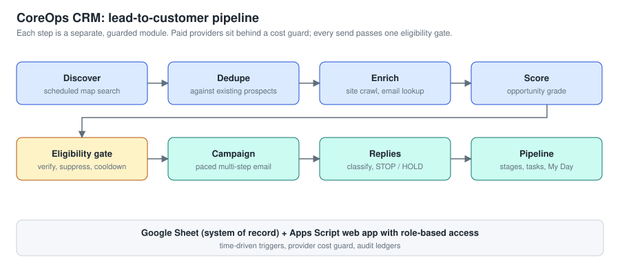
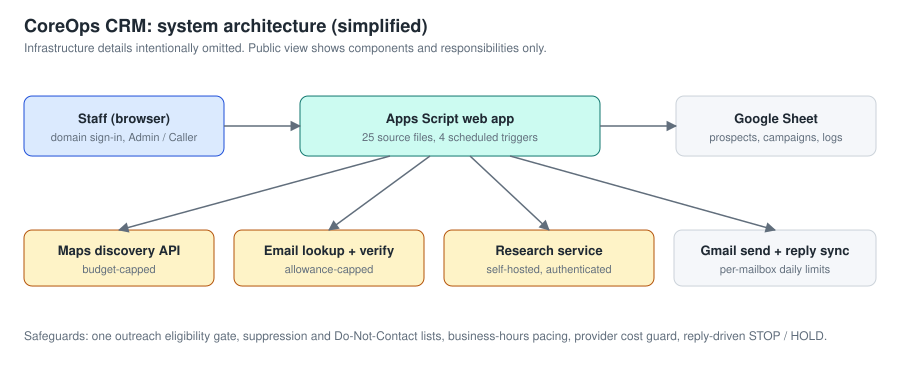

# Case Study 3: CoreOps CRM and Lead-Generation Platform

**Focus:** operations, lead generation, and automation architecture
**Role:** product owner and system designer; built with AI coding assistants; tested and operated by me
**Status:** in production for my commercial cleaning business (private repository)

> The source repository is private. This page describes the system at a high level. It omits credentials, customer data, and infrastructure details.

## Executive summary

I run a commercial cleaning business. New accounts come from finding the right facilities, reaching the right person, and following up without annoying anyone or breaking email rules. I built a CRM that automates the repetitive part of that: finding prospects, researching them, scoring them, and sending paced, guarded outreach, while keeping every decision auditable in a spreadsheet I can read.

## The business problem

- Prospecting by hand is slow and inconsistent.
- Paid data providers charge per use, so uncontrolled automation costs real money.
- Cold email done carelessly burns sender reputation and annoys people.
- A single owner-operator cannot babysit the process daily.

## Requirements

1. Find businesses in my service areas on a schedule.
2. Research and score each one so effort goes to the best fits.
3. Send outreach only when strict eligibility rules pass.
4. Cap spend on every paid provider.
5. Handle replies safely: stop, hold, or move to the sales pipeline.
6. Give staff a simple interface with role-based access.

## Solution

### Design principles

- **One gate for outreach.** A single eligibility function decides whether a lead may be emailed. Every path goes through it.
- **Guards before growth.** Provider budgets, per-mailbox daily limits, business-hours pacing, and a global ceiling are built in and enforced in code.
- **Ledgers everywhere.** Runs, verification results, sends, and reply classifications are logged, so any outcome can be traced.
- **Conservative defaults.** Guessed email addresses wait for verification. Replies like "stop" suppress contact automatically.

## Verified functionality

Legend: **Operating** = observed working in production use. **In code** = present and covered by review or tests, not independently observed running. **Not built** = absent.

| Capability | Status | Basis |
|---|---|---|
| Scheduled business discovery from map search | Operating | Daily runs with a 20-per-day target and cost cap, recorded in a run ledger |
| Dedupe, website research, email lookup, scoring | Operating | Production runs recorded in the sheet; automated tests cover the research paths |
| Email verification (MX check plus provider) | Operating | Verification ledger |
| Multi-step campaign sending with limits and pacing | Operating | Well over a hundred recorded sends under the configured limits |
| Reply classification and safety actions | Operating | Classification ledger; automated tests |
| Provider cost guard | Operating | Budget tracking and holds observed |
| Pipeline: opportunities, stages, tasks, My Day | In code | Source review |
| Command Center reporting | In code | Source review |
| Public-data buying signals (permits, bids) | In code | Source review, optional daily trigger |
| Website inquiry intake | In code | One-minute trigger defined |
| Proposal generation and e-signature | Not built | Not part of this system |

Engineering evidence: about 7,900 lines of Apps Script across 25 source files, five automated test files (all pass when I ran them locally on 2026-10-26), 33 commits, and written architecture and handoff documents.

## My role

- Defined the business process, the safeguards, and the order of operations.
- Directed AI assistants to implement each module and reviewed what they produced.
- Wrote and maintained the operating documentation, including a verified-versus-historical status system for every claim.
- Operate it: monitor runs, review replies, adjust limits, decide what ships.

## Challenges and lessons

- **Reliability of a helper service.** An internal research service fell over under load. The fix was bounded requests plus a rebuildable source tree, and a rule that production fixes must exist in version control.
- **Cost control is a feature.** The budget guard came before scaling discovery.
- **Documentation honesty.** I tag every status line as verified or historical. It prevents acting on stale facts.
- **Compliance details matter.** Sending rules, suppression, and sender identity need attention before volume increases.

## Results

- Automated daily prospecting and guarded outreach running in production.
- Discovery capped by budget and daily targets, outreach capped per mailbox.
- Auditable record of every run and send.

Not yet measured: the number of customer accounts won through this system. I plan to track it.
