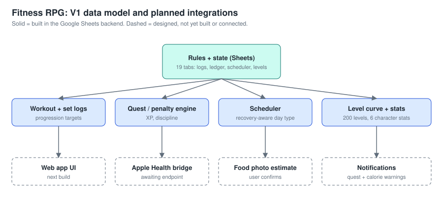
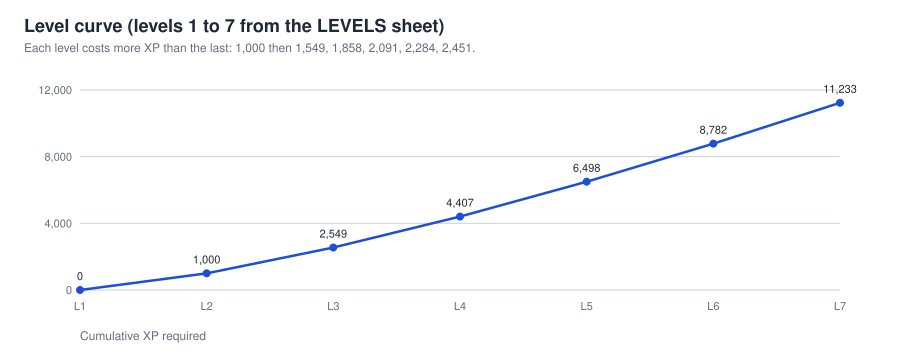

# Case Study 4: Fitness RPG (V1 Data Model and Game Design)

**Focus:** application design around user requirements and structured data
**Role:** designer, with AI-assisted spreadsheet and script building
**Status:** design prototype. The data backend exists. The playable app and device integrations are not built.

## Executive summary

Fitness RPG turns training into a game: daily quests, XP, a discipline score, a level curve, and a scheduler that adapts to recovery. I designed the full data model first, in a Google Sheets backend, so the rules could be inspected and changed before any interface was built. This case study shows how I turn a vague idea into structured data and explicit rules.

## What exists and what does not

| Area | State | Notes |
|---|---|---|
| Data model | Built | 19 tabs covering settings, plan, logs, ledger, scheduler, milestones, stats |
| Workout plan | Built | Block 1 full-body template with substitutions, rep ranges, rest, RPE |
| Quest and penalty engine | Built | Seven daily quests with XP, discipline reward, and miss penalty |
| Level curve | Built | 200 levels with rank bands |
| Scheduler | Built | Day type, intensity, and cardio prescription driven by recovery inputs |
| Character stats | Built | Six stats linked to the data that drives them |
| Daily summary engine | Partly working | Formula columns exist; some empty-state cells show spreadsheet errors until data is entered |
| Apple Health bridge | Designed | Marked "waiting for endpoint deployment" |
| Food photo estimation | Designed | Schema ready; model call not connected |
| Web app | Not built | Listed as next build |
| Real usage data | None yet | Logs are empty |

I list the gaps up front. This is a design project, not a shipped product.

## Requirements I wrote

- Logging a working set takes only weight and reps. The system works out progression and next targets.
- Pain or low recovery reduces intensity or substitutes movements automatically, with manual override.
- XP and earned achievements are permanent. Penalties hit discipline, streaks, and reward eligibility instead of deleting progress.
- Raw health data is imported first and kept untouched, so rules can change without losing source records.
- Food estimates from photos require user confirmation before they count.

## Architecture

### Level curve

### Design decisions

- **Spreadsheet first.** Rules live in cells I can read. Migration to a database is planned once the rules settle.
- **Ledger pattern.** XP changes post to an append-only ledger, which makes the score auditable.
- **Raw import layer.** Health samples land in a raw table with a sync ID for deduplication before any calculation touches them.
- **Planned bridge.** Phone shortcut posts JSON to a script endpoint that deduplicates and appends. Endpoint not yet deployed.

## My role

I defined the requirements, game rules, data model, and integration plan, and used AI assistance to build the sheets.

## Lessons

- Designing the data first made later interface work easier to scope.
- Empty-state formulas need guards. Errors in blank rows are a polish item on the list.
- A design project should say it is one. Clear status builds more trust than a big feature list.

## Next steps

1. Fix empty-state formula errors.
2. Deploy the health-data endpoint and test deduplication.
3. Build the daily mission screen.
4. Log real training for four weeks and review the numbers.
